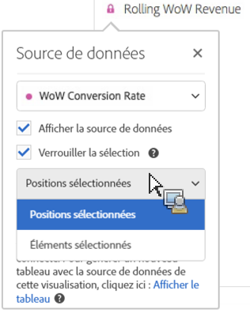

# Gérer des sources de données {#manage-data-sources}

>[!CONTEXTUALHELP]
>id="workspace_freeformtable_lockselection"
>title="Verrouiller la sélection"
>abstract="Activez ce paramètre pour verrouiller la visualisation sur les positions ou les éléments sélectionnés dans la source de données."

>[!CONTEXTUALHELP]
>id="workspace_freeformtable_lockselection_showtable"
>title="Afficher le tableau"
>abstract="Sélectionnez **[!UICONTROL Afficher le tableau]** pour générer une nouvelle source de données pour la visualisation actuelle, distincte de la source de données d’origine."

>[!CONTEXTUALHELP]
>id="workspace_freeformtable_showtable"
>title="Afficher le tableau"
>abstract="Sélectionnez **[!UICONTROL Afficher le tableau]** pour générer une nouvelle source de données pour votre visualisation actuelle, distincte de la source de données d’origine."

Dans Analysis Workspace, chaque visualisation repose sur une source de données, généralement un tableau à structure libre. La synchronisation des visualisations vous permet de contrôler quel tableau à structure libre ou quelle source de données correspond à une visualisation, et si la visualisation reste verrouillée sur des lignes spécifiques dans ce tableau.

>[!TIP]
>
>Vous pouvez savoir quelles visualisations sont liées d’après la couleur de l’icône  à côté du titre des visualisations. Les mêmes couleurs signifient que les visualisations reposent sur la même source de données.
>

<!--
**Tip:** You can tell which visualizations are related by the color of the dot next to the title. Matching colors mean that visualizations are based on the same data source.

Managing a data source lets you show the data source or lock the selection. These settings determine how the visualization changes (or doesn't change) when new data comes in.

1. [Create a project](/help/analyze/analysis-workspace/home.md) with a data table and a [visualization](/help/analyze/analysis-workspace/visualizations/freeform-analysis-visualizations.md).
1. In the data table, select the cells (data source) you want to associate with the visualization.
1. In the visualization, click the dot next to the title to bring up the **[!UICONTROL Data Source]** dialog. Select **[!UICONTROL Show Data Source]** or **[!UICONTROL Lock Selection]**.

   

   Synchronizing a visualization to a table cell creates a new (hidden) table and color-codes the synchronized visualization with that table.

>[!BEGINSHADEBOX]

See  [Data source settings](https://video.tv.adobe.com/v/328077?captions=fre_fr&quality=12&learn=on){target="_blank"} for a demo video.

>[!ENDSHADEBOX]

-->

## Configurer les paramètres de la source de données {#configure}

1. Dans Analysis Workspace, accédez à la visualisation dont vous souhaitez configurer les paramètres de source de données ou de verrouillage.

1. Pointez sur la visualisation, puis sélectionnez l’icône **[!UICONTROL Paramètres]** .

1. Sélectionnez l’onglet **[!UICONTROL Source de données]**.

   

1. Configurez l’un des paramètres suivants :

   | Paramètre | Description |
   | --- | --- |
   | **[!UICONTROL Source de données]** | Sélectionnez la source de données sur laquelle la visualisation est basée. |
   | **[!UICONTROL Visualisations liées]** | Répertorie toutes les visualisations liées à la source de données (tableau à structure libre). |
   | **[!UICONTROL Afficher la source de données]** | Afficher ou masquer la source de données (tableau à structure libre) correspondant à la visualisation. |
   | **[!UICONTROL Verrouiller la sélection]** | Verrouillez la visualisation sur les lignes actuellement sélectionnées dans la source de données, puis sélectionnez **[!UICONTROL Positions sélectionnées]** ou **[!UICONTROL Éléments sélectionnés]**. Voir [Verrouiller la sélection](#lock-selection). |

## Verrouiller la sélection {#lock-selection}

Le verrouillage de la sélection permet de garder une visualisation axée sur les lignes sélectionnées dans sa source de données, même lorsque le tableau change. Par exemple, le tableau change lorsque vous le triez ou le filtrez, modifiez sa période ou appliquez un segment. Une visualisation verrouillée affiche  en regard de son titre.

Si les segments, dimensions ou mesures de la source de données changent et que les données verrouillées ne sont plus visibles, sélectionnez **[!UICONTROL Afficher le tableau]** pour générer une nouvelle source de données pour la visualisation, distincte de la source de données d’origine.

Lorsque vous verrouillez la sélection, choisissez l’une des options suivantes :

| Option | Description |
| --- | --- |
| **[!UICONTROL Postes sélectionnés]** | Verrouille la visualisation aux **positions** des lignes sélectionnées dans la source de données. Ces postes continuent d&#39;être visualisés, même si les éléments qui les composent changent. Par exemple, sélectionnez cette option pour toujours afficher les cinq premiers noms de campagne dans la source de données, quelles que soient les campagnes.  Si vous verrouillez des lignes de répartition qui ne figurent plus dans le tableau, la visualisation ne s’affiche pas. Pour le réafficher, mettez à jour le tableau (par exemple, sa période, ses segments ou ses filtres) ou mettez à jour la sélection du verrouillage. |
| **[!UICONTROL Éléments sélectionnés]** | Verrouille la visualisation sur les **éléments** spécifiques sélectionnés dans la source de données. Ces éléments continuent à être visualisés, même si leur classement dans le tableau change. Par exemple, sélectionnez cette option pour afficher toujours les cinq mêmes noms de campagne, quel que soit leur classement. |
